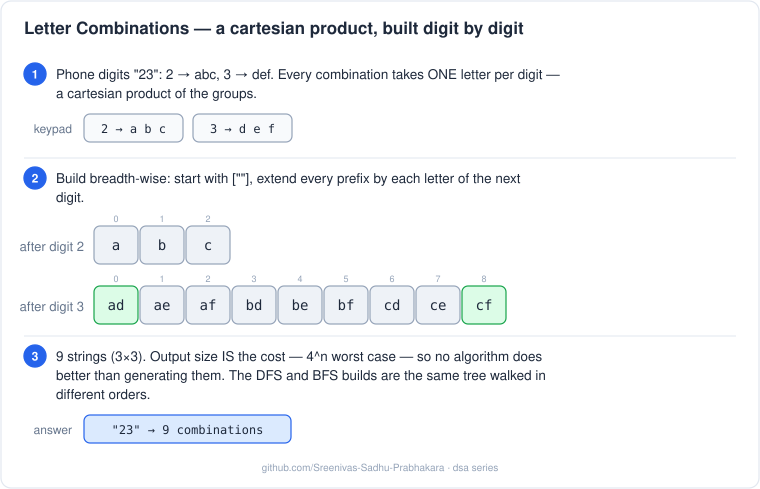

# Letter Combinations of a Phone Number

> NeetCode 150 · Backtracking — a cartesian product over the keypad groups: one recursion level per digit, one loop per letter. Go, stdlib only, tested.

## Problem

Old phone keypads mapped digits to letters (2=abc … 9=wxyz). For a digit string, produce every possible letter string — "23" gives the nine ad/ae/…/cf combinations.

## Approach

The cleanest instance of backtracking-as-cartesian-product: position i of the output is chosen from digit i's letter group, so the recursion tree has one level per digit and the leaves are exactly the combinations. A shared byte buffer appends, recurses, truncates; lexicographic output falls out of the keypad strings being sorted. Two spec edges worth their tests: the empty digit string yields an empty *list* (not a list holding ""), and digits 0/1 carry no letters — this implementation rejects the whole input rather than silently skipping them.

**Complexity:** O(output) = up to 4ⁿ·n; O(n) depth.

## Visual walkthrough

Read the picture top to bottom — each numbered frame is one moment of the algorithm
running on this repo's test example.

## Run

    go test ./...   # verify
    go run .        # demo

---

Part of a 275-repo DSA series in Go — Striver's SDE Sheet (dsa-001–191) plus the NeetCode 150 / Blind 75 additions (dsa-192–275), stdlib only, every solution tested. Browse: [`dsa-*` repos](https://github.com/Sreenivas-Sadhu-Prabhakara?tab=repositories&q=dsa-&type=source).
